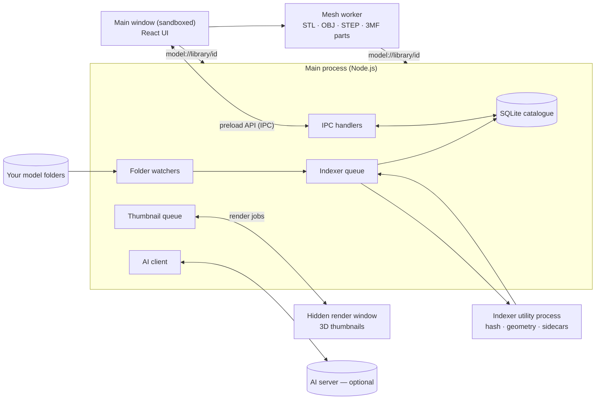
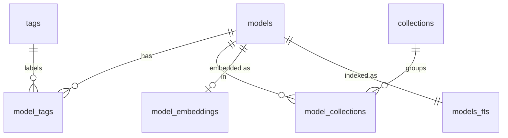

# Architecture

How MeshVault is put together, and why. Read this before changing anything that crosses a process
boundary, touches the database schema or changes how files are read.

- [Processes](#processes)
- [Source layout](#source-layout)
- [Data model](#data-model)
- [Life of a file](#life-of-a-file)
- [Renderer](#renderer)
- [Protocols and IPC](#protocols-and-ipc)
- [Background work](#background-work)
- [Design decisions](#design-decisions)

## Processes



| Process | Responsibilities | Has Node.js? |
| --- | --- | --- |
| **Main** (`electron/main.ts`) | Database, file system, dialogs, protocols, queues, updates, AI client | Yes |
| **Indexer worker** (`electron/indexer/worker.ts`, an Electron utility process) | Hashing, mesh statistics, sidecar discovery, preview images (sharp). No database access: it returns results to the main process. | Yes |
| **Main window** (`src/`) | The interface. Sandboxed, context-isolated, served from `app://bundle`. | No |
| **Mesh worker** (`src/workers/meshWorker.ts`, a Web Worker) | Parses STL, OBJ, STEP and multi-part 3MF into transferable buffers | No |
| **Render window** (same bundle, `#thumbnail-renderer`) | Hidden window that draws 3D thumbnails; created on demand, closed after 60 s idle | No |

The main process owns every write. Everything else either asks it (IPC) or reads through a protocol
it serves.

## Source layout

```
electron/                    main process
  main.ts                    startup, windows, media:// protocol, shutdown sequence
  security.ts                app:// protocol, window hardening, user-granted paths
  modelProtocol.ts           model://library/<id>: streams library files from disk
  preload.ts                 the only API the renderer sees (contextBridge)
  ipcHandlers.ts             IPC channels; validates arguments, delegates to library/
  database.ts                connection + ordered migrations (PRAGMA user_version)
  library/                   catalogue logic, split by concern
    core.ts                  events, supported extensions, thumbnail ranking
    rows.ts                  row ↔ Model mapping, tag/collection hydration
    query.ts                 list queries built from FilterOptions + search syntax
    searchIndex.ts           FTS5 document maintenance
    records.ts               import, remove, missing-file tracking, stats
    updates.ts               analysis results, thumbnails, metadata, rename
    ai.ts                    enrichment inputs/outputs, categories, tag names
    similarity.ts            duplicates, embeddings, find-similar
  fileWatcher.ts             chokidar watchers, folder sync, drive availability polling
  indexer/                   job queue (index.ts) and utility process (worker.ts)
  analyzers/                 STL / OBJ / 3MF / glTF parsers, hashing, sidecars
  thumbnails.ts              render queue and the hidden render window lifecycle
  zipImport.ts               safe ZIP extraction into a watched folder
  slicers.ts                 slicer discovery and launching
  ai/                        provider client, prompts, enrichment queue, embeddings
  updater.ts                 electron-updater integration
  logger.ts                  console → logs/main.log
  settings.ts                key/value settings table
src/                         renderer (React)
  App.tsx, main.tsx          shell, drag-and-drop, lazy dialogs, thumbnail-renderer entry
  components/                grid, sidebar, filter bar, dialogs
  components/viewer/         viewer canvas, toolbar, side-panel sections, actions
  store/                     Zustand store composed from slices (types.ts + slices/)
  lib/modelLoader.ts         loads models (worker first, page fallback), disposal
  lib/meshTransfer.ts        Object3D ↔ transferable mesh data
  lib/searchQuery.ts         search syntax parser, shared with the main process
  workers/meshWorker.ts      off-thread parser
  thumbnails/                thumbnail renderer used by the hidden window
tests/                       vitest unit tests
scripts/e2e/                 end-to-end runner driving the real app over CDP
```

## Data model

SQLite in WAL mode, file `modelist.db` in the library folder. The schema version lives in
`PRAGMA user_version`; `electron/database.ts` applies numbered migrations in order, each in its own
transaction, with foreign keys switched off during migrations (a migration may rebuild a table).



| Table | Holds |
| --- | --- |
| `models` | one row per file: path, type, size, hash, geometry (triangles, bbox, volume), print metadata, README text, thumbnail path and source, AI metadata, `missing_since` |
| `tags`, `model_tags` | coloured tags, many-to-many |
| `collections`, `model_collections` | user collections and watched folders (`type`), many-to-many |
| `models_fts` | FTS5 trigram index: name, folder, tags, source fields, 3MF fields, README, AI text |
| `model_embeddings` | embedding vector per model, with the model name and dimensions |
| `settings` | JSON values keyed by name (AI settings, slicers, bed size, …) |

**Changing the schema:** append a migration to `MIGRATIONS` with the next version number. Never edit a
released migration. Make it safe to run on databases created by any earlier version (check columns
before adding them), and add a case to `tests/database.test.ts`, which upgrades a v1 database.

## Life of a file

1. **Discovery.** A folder scan (`syncFolder`) or a watcher event finds `part.stl`. `importModel`
   inserts a row and its FTS document; the model is visible immediately.
2. **Analysis.** The indexer queue sends a job to the utility process, which hashes the file (skipped
   when size and mtime are unchanged), parses geometry and 3MF metadata, looks for sidecars, and turns
   an embedded or sidecar preview into a thumbnail. Each job has a timeout; a file that crashes the
   worker twice is reported and skipped.
3. **Applying results.** The main process stores the results, refreshes the FTS document and, if the
   model has no thumbnail at least as good as a 3D render, queues a render.
4. **Rendering.** The thumbnail queue opens the hidden render window if needed and sends it one job at a
   time; the window loads the model (through the mesh worker), renders 512×512 and returns a PNG.
5. **Enrichment** (optional). New models can be queued for the AI assistant.
6. **Notification.** `models-updated` events are debounced (300 ms) and the UI refreshes the loaded
   page in place.

**Thumbnail ranking** — a better source is never replaced by a worse one:
user capture > embedded 3MF image > sidecar image > 3D render > generic folder image.

**Missing files.** Watcher `unlink` events and a 10-second availability poll of every watched root
mark models missing instead of deleting them; they are restored when the file or drive returns.

## Renderer

- **State** lives in a Zustand store composed from slices (`notifications`, `ui`, `library`,
  `duplicates`, `selection`, `assistant`, `slicers`). IPC calls that can fail go through `attempt()`,
  which turns errors into toasts.
- **The grid** is virtualised (TanStack Virtual) and pages 200 models at a time.
- **The viewer** (`components/viewer/`) uses react-three-fiber. Side-panel sections are keyed by model id,
  so their local state resets when another model opens; view settings persist.
- **Model loading** (`lib/modelLoader.ts`): STL, OBJ, STEP and large or multi-part 3MF are parsed in the
  mesh worker, which fetches the bytes from `model://` itself and transfers the vertex buffers back.
  GLB, USDZ and colour 3MF use loaders that need the DOM, so they are parsed on the page. If a worker
  cannot start, everything falls back to the page.
- **GPU memory** is released explicitly: geometries, materials and textures are disposed when a model
  is closed.
- **Lazy loading**: the viewer, dialogs and the STEP engine (OpenCASCADE, 7.6 MB WASM) load on first use.

## Protocols and IPC

| Scheme | Serves | Guard |
| --- | --- | --- |
| `app://bundle/…` | the built UI (`dist/`) | paths must stay inside `dist/` |
| `model://library/<id>` | a library file, streamed from disk | id must exist in the catalogue |
| `media://…` | thumbnails | path must be inside the thumbnail folder |

IPC channels are defined in `electron/ipcHandlers.ts` and exposed one-to-one by `electron/preload.ts`;
their TypeScript signatures are the `ElectronAPI` interface in `src/types/index.ts`. Push events
(`models-updated`, `index-progress`, `ai:progress`, `updates:status`, `app:notice`, …) go from main to
the main window only.

**Adding an IPC call:** add the handler (validate every argument — the renderer is untrusted), expose it
in the preload, add it to `ElectronAPI`, and never accept a file-system path from the renderer unless
`isGranted()` confirms the user chose it.

## Background work

| Queue | Where | Concurrency | Safety net |
| --- | --- | --- | --- |
| Indexer | utility process | 2 jobs | per-job timeout (60 s + 250 ms/MB), worker restart, give up after 2 crashes |
| Thumbnails | hidden window | 1 job | 30 s timeout, 2 attempts, window recreated if it crashes |
| AI enrichment | main process (HTTP) | sequential | cancellable, one retry on connection failure |
| Embeddings | main process (HTTP) | batches of 32 | cancellable; stops on a failed batch |

On quit, the app stops the queues, closes the watchers and closes the database before exiting (with a
5-second safety limit), so the WAL is checkpointed cleanly.

## Design decisions

- **Files stay where they are.** The catalogue references files by path; MeshVault is not a file manager.
  Missing files are flagged, not deleted, because drives get unplugged.
- **Main process owns all writes.** One writer avoids SQLite locking issues and keeps validation in one
  place; the utility process only computes.
- **No path ever comes from the renderer unchecked.** File access is by catalogue id; user-supplied
  paths must come from a dialog or a real drop. See [security.md](security.md).
- **Prebuilt Node-API binaries** (better-sqlite3 13, sharp) work in Electron unchanged, so building the
  app needs no C++ toolchain and no native rebuild.
- **Search uses FTS5 with the trigram tokenizer**, so partial words and non-English names match without
  language-specific stemming; very short terms fall back to `LIKE`.
- **Legacy names are kept where renaming would break existing installs**: the app id, the database file
  name and the old `Modelist` library folder.
